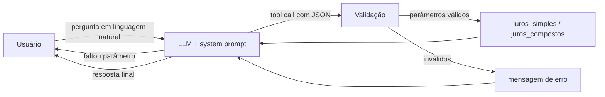

# Assistente Financeiro com LLM e Tool Calling

Assistente de educação financeira no terminal que conversa em linguagem natural e **delega os cálculos a funções Python**, em vez de deixar o modelo fazer contas.

## Problema

LLMs são bons para entender perguntas como *"quanto rendem 5 mil a 12% ao ano em um ano e meio?"*, mas não são confiáveis para aritmética: podem errar contas, confundir taxa anual com mensal ou inventar um valor com aparência plausível. Em finanças, um número errado com tom confiante é pior do que nenhuma resposta.

**Abordagem:** o LLM interpreta a pergunta e extrai os parâmetros; o cálculo é feito por código determinístico e testado. Cada parte faz o que faz melhor.

## Como funciona



1. O **system prompt** define o papel do assistente e as regras: usar sempre as ferramentas para calcular, perguntar quando faltar valor, taxa ou prazo, e não fazer recomendação de investimento.
2. O modelo decide **se** e **qual** ferramenta chamar, e extrai os parâmetros em JSON. Isso também resolve formatos brasileiros como "5 mil" ou "5.000,00", que quebrariam um `float(input())`.
3. Os parâmetros são **validados** antes do cálculo. Erros voltam ao modelo como mensagem, sem derrubar o programa.
4. O resultado da função volta ao modelo, que redige a resposta. O loop permite várias chamadas por pergunta (por exemplo, comparar simples e compostos), com limite de 5 iterações.

### Exemplo do fluxo

Pergunta: *"Quanto rendem 5 mil a 12% ao ano em 18 meses com juros compostos?"*

Chamada gerada pelo modelo:
```json
{"name": "juros_compostos", "arguments": {"principal": 5000, "taxa_anual": 12, "meses": 18}}
```

Retorno da função:
```json
{"montante": 5926.48, "juros": 926.48, "taxa_mensal_equivalente_pct": 0.9489}
```

## Decisões técnicas

| Decisão | Motivo |
|---|---|
| Tool calling em vez de `if "juros" in texto` | O modelo entende variações da pergunta e extrai os parâmetros; regras por palavra-chave quebram com qualquer reformulação |
| Taxa anual tratada como **efetiva** | É o padrão no mercado brasileiro. 12% a.a. equivalem a 0,9489% a.m., não 1% a.m. |
| Validação antes de executar | O LLM pode gerar parâmetros faltando, negativos ou JSON inválido |
| Histórico limitado a 20 mensagens | Controla custo e tamanho do contexto |
| Chave da API por variável de ambiente | Evita commitar credenciais |
| Modelo configurável (`OPENAI_MODEL`) | Permite trocar de modelo sem alterar o código |

## Como executar

```powershell
pip install -r requirements.txt
$env:OPENAI_API_KEY = "sua-chave"     # Linux/Mac: export OPENAI_API_KEY="sua-chave"
python assistente_financeiro.py
```

Opcional: `$env:OPENAI_MODEL = "nome-do-modelo"` (padrão: `gpt-4o-mini`; confira os modelos disponíveis na documentação da OpenAI).

### Testes

```powershell
python -m pytest -q
```

Os testes cobrem as funções de cálculo e a validação de parâmetros, sem chamar a API: juros simples, equivalência de taxa efetiva (12% a.a. em 12 meses resultam em exatamente 12%), rejeição de valores negativos, parâmetros faltando e JSON inválido.

## Limitações

- **Apenas dois cálculos.** Juros simples e compostos sobre um valor inicial, sem aportes mensais, inflação, IR ou taxas.
- **Comportamento do modelo não é testado automaticamente.** Os testes garantem os cálculos, mas não que o modelo sempre chame a ferramenta certa ou extraia os parâmetros corretamente.
- **Interface de terminal**, sem histórico persistente entre sessões.
- **Uso educacional.** Não substitui orientação de um profissional certificado.

## Próximos passos

- **Avaliação do agente:** conjunto de perguntas com a ferramenta e os parâmetros esperados, medindo a taxa de acerto do modelo.
- **Novas ferramentas:** aportes mensais, comparação entre investimentos e correção pela inflação.
- **Interface web** com Streamlit e deploy.

## Estrutura

```
├── assistente_financeiro.py   # system prompt, ferramentas, validação e loop do agente
├── tests/
│   └── test_ferramentas.py    # testes dos cálculos e da validação
└── requirements.txt
```
