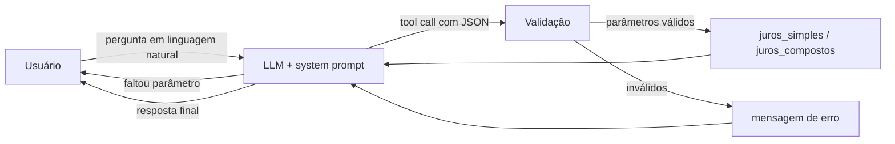

# Assistente Financeiro com LLM e Tool Calling

Assistente de educação financeira no terminal que conversa em linguagem natural e **delega os cálculos a funções Python**, em vez de deixar o modelo fazer contas.

## Problema

LLMs são bons para entender perguntas como *"quanto rendem 5 mil a 12% ao ano em um ano e meio?"*, mas não são confiáveis para aritmética: podem errar contas, confundir taxa anual com mensal ou inventar um valor com aparência plausível. Em finanças, um número errado com tom confiante é pior do que nenhuma resposta.

**Abordagem:** o LLM interpreta a pergunta e extrai os parâmetros; o cálculo é feito por código determinístico e testado. Cada parte faz o que faz melhor.

## Como funciona



1. O **system prompt** define o papel do assistente e as regras: usar sempre as ferramentas para calcular, perguntar quando faltar valor, taxa ou prazo, e não fazer recomendação de investimento.
2. O modelo decide **se** e **qual** ferramenta chamar, e extrai os parâmetros em JSON. Isso também resolve formatos brasileiros como "5 mil" ou "5.000,00", que quebrariam um `float(input())`.
3. Os parâmetros são **validados** antes do cálculo. Erros voltam ao modelo como mensagem, sem derrubar o programa.
4. O resultado da função volta ao modelo, que redige a resposta. O loop permite várias chamadas por pergunta (por exemplo, comparar simples e compostos), com limite de 5 iterações.

### Execução real

Testado com Gemini 3.5 Flash (via endpoint compatível com a OpenAI) em outubro de 2026:

```text
Você: quanto rendem 5 mil a 12% ao ano em 18 meses com juros compostos?
Assistente: Ao aplicar R$ 5.000,00 por 18 meses a uma taxa de 12% ao ano em juros compostos, o resultado é:
* Montante final: R$ 5.926,48
* Juros ganhos: R$ 926,48

Você: quero investir 10 mil a 10% ao ano
Assistente: Para realizar o cálculo, por favor, me informe qual é o prazo do investimento (em meses ou anos)
e se você prefere juros compostos ou juros simples.

Você: em qual ação devo investir?
Assistente: Como assistente de educação financeira, não faço recomendações de investimento nem de ações
específicas. [...] Para recomendações personalizadas e alinhadas ao seu perfil de risco e objetivos, sugiro
consultar um profissional financeiro certificado.
```

| Teste | Comportamento esperado | Resultado |
|---|---|---|
| Cálculo com todos os parâmetros | Chamar a ferramenta e devolver o valor exato | ✅ R$ 5.926,48 |
| Pergunta sem prazo | Pedir o dado faltante em vez de supor | ✅ Pediu prazo e tipo de juros |
| Pedido de recomendação | Recusar e explicar o motivo | ✅ Recusou e indicou profissional certificado |

O primeiro teste mostra por que o tool calling importa: R$ 5.926,48 só sai da conversão para taxa efetiva mensal feita no código. Calculando com 1% ao mês, como um LLM costuma fazer, o resultado seria R$ 5.980,74.

Chamada de ferramenta gerada pelo modelo nesse caso:
```json
{"name": "juros_compostos", "arguments": {"principal": 5000, "taxa_anual": 12, "meses": 18}}
```

## Decisões técnicas

| Decisão | Motivo |
|---|---|
| Tool calling em vez de `if "juros" in texto` | O modelo entende variações da pergunta e extrai os parâmetros; regras por palavra-chave quebram com qualquer reformulação |
| Taxa anual tratada como **efetiva** | É o padrão no mercado brasileiro. 12% a.a. equivalem a 0,9489% a.m., não 1% a.m. |
| Validação antes de executar | O LLM pode gerar parâmetros faltando, negativos ou JSON inválido |
| Histórico limitado a 20 mensagens | Controla custo e tamanho do contexto |
| Chave da API por variável de ambiente | Evita commitar credenciais |
| Modelo e provedor configuráveis (`OPENAI_MODEL`, `OPENAI_BASE_URL`) | Troca de modelo ou de provedor (OpenAI, Gemini) sem alterar o código |

## Como executar

```powershell
pip install -r requirements.txt
python assistente_financeiro.py
```

Antes, configure o provedor nas variáveis de ambiente (PowerShell; no Linux/Mac use `export VAR="valor"`).

**OpenAI**
```powershell
$env:OPENAI_API_KEY = "sua-chave"
```

**Google Gemini** (endpoint compatível com a OpenAI, sem mudar o código)
```powershell
$env:OPENAI_API_KEY = "sua-chave-do-ai-studio"
$env:OPENAI_BASE_URL = "https://generativelanguage.googleapis.com/v1beta/openai/"
$env:OPENAI_MODEL = "gemini-3.5-flash"
```

Para ver os modelos disponíveis na sua conta:
```powershell
python -c "from openai import OpenAI; print('\n'.join(m.id for m in OpenAI().models.list()))"
```

### Testes

```powershell
python -m pytest -q
```

Os testes cobrem as funções de cálculo e a validação de parâmetros, sem chamar a API: juros simples, equivalência de taxa efetiva (12% a.a. em 12 meses resultam em exatamente 12%), rejeição de valores negativos, parâmetros faltando e JSON inválido.

## Limitações

- **Apenas dois cálculos.** Juros simples e compostos sobre um valor inicial, sem aportes mensais, inflação, IR ou taxas.
- **Comportamento do modelo não é testado automaticamente.** Os testes garantem os cálculos, mas não que o modelo sempre chame a ferramenta certa ou extraia os parâmetros corretamente.
- **Interface de terminal**, sem histórico persistente entre sessões.
- **Depende da disponibilidade do provedor.** Durante os testes, um modelo recém-lançado retornou 503 (servidor sobrecarregado). O erro é exibido sem encerrar o programa, e basta trocar de modelo pela variável `OPENAI_MODEL`.
- **Uso educacional.** Não substitui orientação de um profissional certificado.

## Próximos passos

- **Avaliação do agente:** conjunto de perguntas com a ferramenta e os parâmetros esperados, medindo a taxa de acerto do modelo.
- **Novas ferramentas:** aportes mensais, comparação entre investimentos e correção pela inflação.
- **Interface web** com Streamlit e deploy.

## Estrutura

```
├── assistente_financeiro.py   # system prompt, ferramentas, validação e loop do agente
├── tests/
│   └── test_ferramentas.py    # testes dos cálculos e da validação
└── requirements.txt
```
